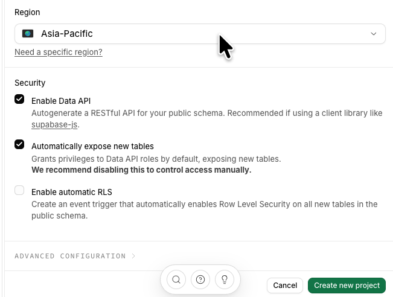
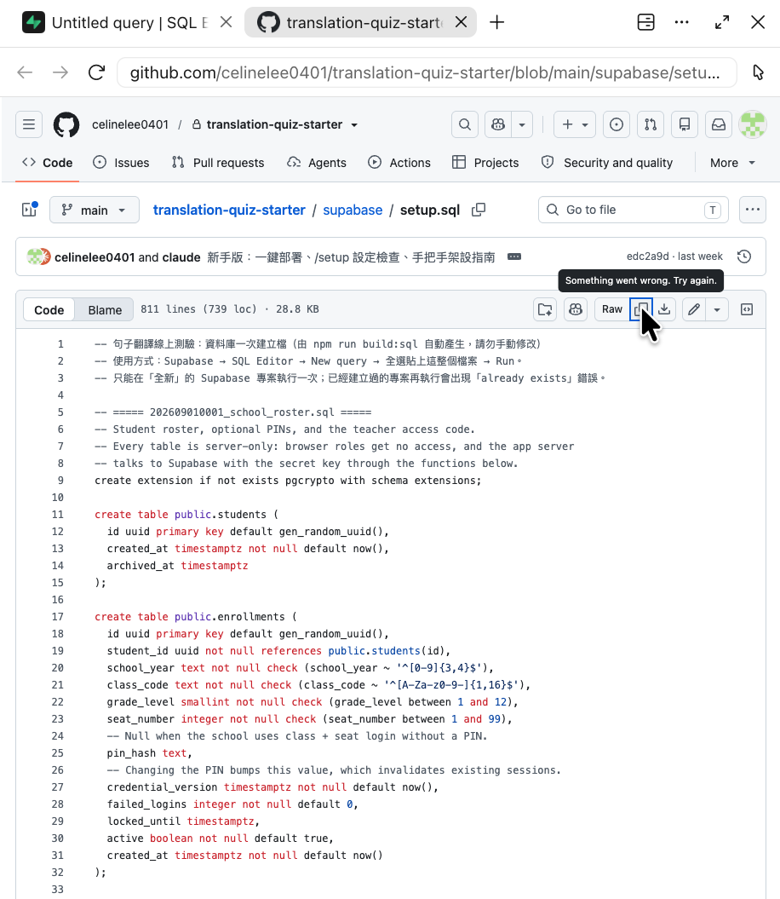
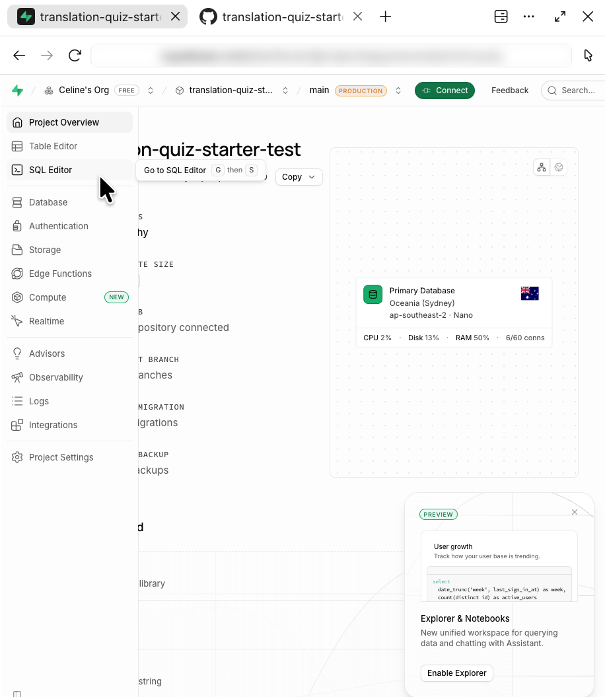
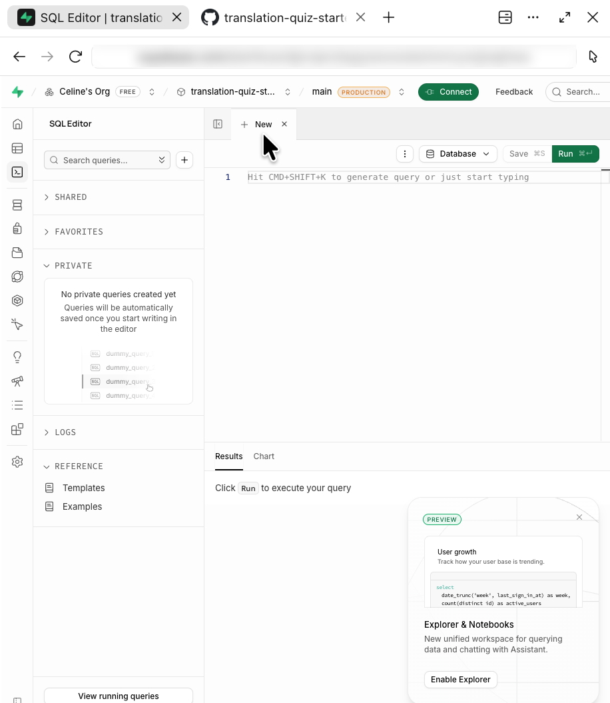
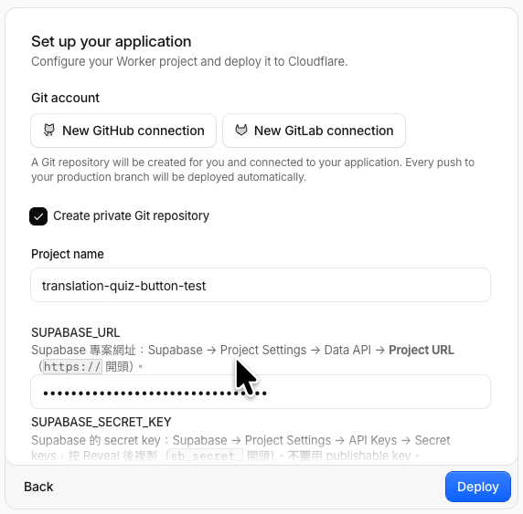
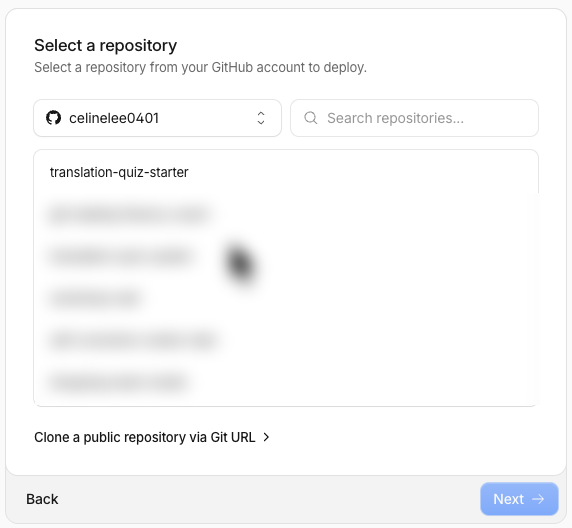
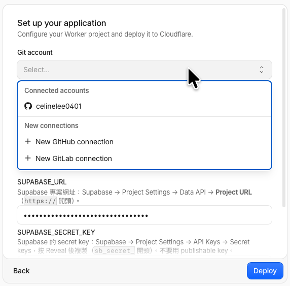
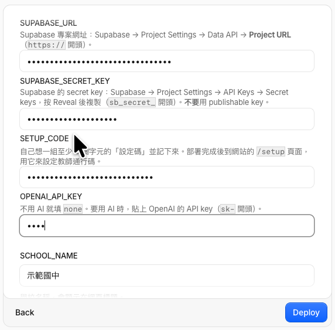
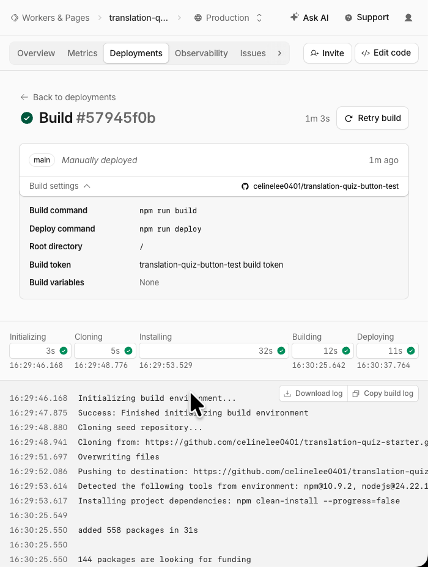

# 新手架設指南：從零做出自己的線上句子翻譯測驗

> **老師請看這裡：** 把這個網址交給你的 AI 助理（ChatGPT、Claude、Gemini、Codex 都可以），然後對它說：
>
> 「請讀這份指南，依照裡面『給 AI 助理的帶領規則』，一步一步帶我架設。每次只告訴我一步，我做完會截圖給你。」
>
> 接下來你只要照 AI 說的做、做完截圖給它就好。不需要自己讀完這份文件。

---

## 給 AI 助理的帶領規則（AI 請先讀完整份文件再開始）

你要陪一位**不會寫程式**的英文老師，照這份指南架設「句子翻譯線上測驗」網站。全程使用免費方案，不需要安裝軟體或打指令。

**帶領方式**

1. 用繁體中文、親切簡短的語氣。**一次只給一個步驟**（指南裡的一個小項目，例如「點 New project」），不要一次列出整個大步驟。
2. 每給一步，就告訴老師「做完請截圖給我」或「做完回覆『好了』」。收到後，對照該步驟的 **✅ 檢查點** 判斷是否完成：
   - 符合 → 稱讚一句，給下一步。
   - 不符合或看不懂 → 說明畫面上哪裡不對，請老師再試，或請老師截更完整的畫面。
3. 網站介面可能改版：畫面和指南不完全一樣時，依截圖找意思相近的按鈕，不要堅持指南上的文字。
4. 每完成一個大步驟（步驟 1、2、3…），告訴老師「已完成第幾步，總共 9 步」。
5. 開始前先問老師這 5 件事，並把答案記住，步驟 5 會用到：
   - 學校名稱？
   - 有哪些班級、各是幾年級？→ 幫老師整理成 `801:8, 802:8` 的格式。
   - 目前學年？（例：`115`）
   - 學生登入要不要 PIN？正式成績請選要（`pin`）；不要 PIN（`seat`）時任何人都能冒用座號，只適合練習。
   - 要不要 AI 批改建議？建議先不要（`none`），熟悉後再開。
6. 老師如果已經做過某些步驟（例如已有 GitHub 帳號），跳過即可。

**安全規則（一定要遵守）**

- 標示 **🔒** 的步驟會出現機密（Secret key、設定碼、教師通行碼、OpenAI 金鑰）。**不要請老師截這些畫面**，也不要請老師把機密打字給你；只請老師回覆「好了」。
- 如果老師不小心把機密貼出來或截圖給你：請老師立刻到該網站把那把鑰匙刪掉、重建一把，並更新 Cloudflare 的變數（步驟 6 有說明怎麼改）。不要重複唸出那串機密。
- 試用一律用假座號（例如 `801,99`），不要輸入真實學生資料。
- 只有 OpenAI 會產生費用；啟用前要請老師設定帳單上限。
- 不要建議老師修改程式碼。這份指南的所有步驟都在網頁上完成。

---

## 開始前準備（老師）

- 一台電腦（建議用 Chrome 瀏覽器）、一個常用的 email 信箱。
  - 請用**一般的 Chrome 或 Safari 視窗**操作，不要用 AI 工具或其他 App 裡面內建的瀏覽器：內建瀏覽器的「複製」按鈕有時會失敗。
- 一個記事本（紙本或電腦的記事本都可以），暫時記下等一下會拿到的東西：

| 要記下的東西 | 在哪一步拿到 | 機密嗎？ |
|---|---|---|
| Supabase 資料庫密碼（複製不了可略過，網站用不到） | 步驟 2 | 🔒 自己保存 |
| Project URL（`https://…supabase.co`） | 步驟 4 | 不機密 |
| Secret key（`sb_secret_…`） | 步驟 4 | 🔒 不要給任何人、不要截圖 |
| 設定碼（自己想的密語） | 步驟 5 | 🔒 |
| 網站網址（`https://….workers.dev`） | 步驟 5 | 不機密 |
| 教師通行碼（自己想的密碼） | 步驟 7 | 🔒 |

---

## 步驟 1：註冊 GitHub（約 5 分鐘）

GitHub 是存放網站程式的地方。等一下 Cloudflare 會幫你在這裡複製一份網站程式。已經有帳號的老師可以跳過。

1. 打開 <https://github.com/signup>。
2. 輸入 email、設定密碼、取一個使用者名稱（英文小寫與數字，例如 `wang-teacher`）。
3. 完成機器人驗證，到信箱收驗證碼並輸入。
4. 問卷可以直接略過（Skip）。

✅ **檢查點**：看到 GitHub 首頁，右上角有自己的頭像。

---

## 步驟 2：註冊 Supabase 並建立資料庫（約 10 分鐘）

Supabase 是存放題目、學生名冊和作答紀錄的資料庫。

1. 打開 <https://supabase.com/dashboard/sign-up>，選 **Continue with GitHub**，按 **Authorize**。
2. 如果要求建立 **Organization（組織）**：Name 隨意（例如 `我的學校`）、Type 選 Personal、Plan 選 **Free（$0/month）**，按 **Create organization**。
3. 建立專案（**New project**）：
   - **Project name**：`translation-quiz`
   - **Database Password**：🔒 按 **Generate a password**。能複製就貼到記事本保存；**複製不了也沒關係，直接往下做**。這個網站用不到這組密碼（網站用步驟 4 的 Secret key 連資料庫），日後真的需要時，可以到 Supabase 的 **Project Settings → Database** 重設。
   - **Region**：按下方的 **Need a specific region?**，選 **Northeast Asia (Tokyo)**（離台灣最近）。如果只選大區 **Asia-Pacific** 也能用，但可能被分到雪梨，速度稍慢。
   - 如果有 **Security** 區塊，照下面設定：
     - **Enable Data API**：✅ **保持勾選**（取消的話網站會連不上資料庫）。
     - **Automatically expose new tables**：⬜ **取消勾選**（比較安全；步驟 3 的 SQL 已經設定好誰能讀寫）。
     - **Enable automatic RLS**：勾不勾都可以（步驟 3 的 SQL 會自己開）。

     
     （上圖是預設狀態；請把中間的 **Automatically expose new tables** 取消勾選。）

   - 按 **Create new project**。
4. 等 1–2 分鐘。

✅ **檢查點**：畫面顯示專案首頁（左側有一排選單：Table Editor、SQL Editor 等），沒有在轉圈。

> 提醒：Supabase 免費專案**連續 7 天沒有使用會自動暫停**。暫停時登入 Supabase，按專案上的 **Restore** 就會恢復，資料不會不見。寒暑假後第一次使用前記得檢查。

---

## 步驟 3：建立資料表（約 3 分鐘）

1. 打開這個檔案：<https://github.com/celinelee0401/translation-quiz-starter/blob/main/supabase/setup.sql>
   按檔案右上角的 **複製** 圖示（兩個重疊的方框，Copy raw file），一次複製全部內容。
   - 如果出現 **Something went wrong. Try again.**（複製失敗）：改按旁邊的 **Raw** 按鈕，會打開一頁只有純文字的畫面；在那頁按一下，再按 **全選**（Mac：⌘＋A；Windows：Ctrl＋A）和 **複製**（Mac：⌘＋C；Windows：Ctrl＋C）。

     

2. 回到 Supabase，左側選單點 **SQL Editor**（圖示像 `>_`）。

   

3. 點 **New query**（或「+」），出現空白編輯區。右上角綠色的 **Run** 就是等一下要按的按鈕。

   

4. 在編輯區按一下，**貼上**（Mac：⌘＋V；Windows：Ctrl＋V）。
5. 按右下角綠色的 **Run**。
6. 如果跳出提示說這段 SQL 有「破壞性操作」→ 按 **Run this query** 繼續（全新的專案，不會刪到東西）。

✅ **檢查點**：下方結果區顯示 **Success. No rows returned**。

**常見狀況**
- 出現 `already exists` → 之前已經執行過了，直接進下一步。
- 出現其他紅色錯誤 → 多半是只複製到一部分。清空編輯區，重新複製、貼上、Run。

---

## 步驟 4：複製兩把「鑰匙」（約 3 分鐘）🔒

網站需要這兩樣東西才能連到資料庫。

1. Supabase 左下角點 **Project Settings**（齒輪圖示）。
2. **Project URL**：點 **Data API**，找到 **Project URL**（`https://xxxxxxxx.supabase.co`），複製，貼到記事本。
   ✅ **檢查點（可截圖）**：記事本裡有一串 `https://` 開頭、`.supabase.co` 結尾的網址。
3. 🔒 **Secret key**：點 **API Keys**，找到 **Secret keys** 區塊。
   - **在按 Reveal 之前可以截圖給 AI 確認位置對不對；按了 Reveal 之後就不要截圖。**
   - 已經有一把（通常叫 `default`）→ 按 **Reveal**（眼睛圖示）後按複製。
   - 沒有 → 按 **Create new secret key**（或 **Add new**），名稱填 `quiz`，建立後複製。
   - 貼到記事本。

✅ **檢查點（不要截圖，回覆「好了」即可）**：記事本裡有一串 **`sb_secret_` 開頭** 的長字串。

> ⚠️ 不要複製到 **Publishable key**（`sb_publishable_` 開頭），那不是我們要的。
> ⚠️ **金鑰必須是完整的一整行**（`sb_secret_` 加上後面約 30 個字，中間沒有空格）。貼上後如果被切成兩行，要把中間的換行刪掉，接回一行；只貼到前半段或後半段，網站都會連不上。
> ⚠️ Secret key 等同資料庫的萬用鑰匙：不要截圖、不要貼到 LINE 或任何聊天室（包含 AI 聊天）。

---

## 步驟 5：一鍵部署到 Cloudflare（約 10 分鐘）🔒

Cloudflare 會把網站放上網路，讓學生用網址打開。

1. 打開 <https://deploy.workers.cloudflare.com/?url=https://github.com/celinelee0401/translation-quiz-starter>（這就是 README 上的 **Deploy to Cloudflare** 按鈕）。
2. 還沒有 Cloudflare 帳號 → 按 **Sign up** 註冊（email＋密碼），到信箱點驗證信後回到這個頁面。
3. 出現 **Set up your application** 頁面。**第一次使用**時，Git account 底下只有 **New GitHub connection** 按鈕：
   - 按 **New GitHub connection** → GitHub 會問要不要讓 Cloudflare 存取 → 選你的帳號，按 **Install & Authorize**（選 All repositories 或 Only select repositories 都可以）。

   

   > ⚠️ **如果授權完跑到「Select a repository」（列出你 GitHub 上所有 repo 的頁面）：這是走錯頁了，不要選任何 repo、不要按 Next。** 重新打開第 1 步的連結，回到 Set up your application 頁面。
   >
   > 

4. 回到 Set up your application 頁面後：
   - **Git account**：欄位顯示灰色的 **Select…**，**要點一下**才會跳出清單 → 點 **Connected accounts** 底下你的 GitHub 帳號（不要再點 New GitHub connection）。

     

   - **Create private Git repository**：保持勾選。（Cloudflare 會在你的 GitHub 建一份網站程式，之後改設定不用碰它。）
   - **Project name**：保留 `translation-quiz`，或改成你想要的英文名稱（會出現在網址裡）。

   ✅ **檢查點（可截圖）**：Git account 顯示你的 GitHub 帳號，Project name 已填好。

5. 往下捲，照下表填寫每個欄位（AI 會根據開始前問到的答案告訴你要填什麼）。機密欄位在上面，學校設定在下面：

| 欄位 | 要填什麼 |
|---|---|
| 🔒 `SUPABASE_URL` | 貼上步驟 4 的 Project URL |
| 🔒 `SUPABASE_SECRET_KEY` | 貼上步驟 4 的 Secret key（完整一行） |
| 🔒 `SETUP_CODE` | **自己想一組至少 8 個字的密語**，例如 `月亮喜歡吃蘋果2026`，寫在記事本 |
| 🔒 `OPENAI_API_KEY` | 填 `none` |
| `SCHOOL_NAME` | 學校名稱，例如 `光明國中` |
| `SCHOOL_CLASSES` | 班級與年級，格式 `班級:年級`，用逗號分隔，例如 `801:8, 802:8, 803:8` |
| `SCHOOL_YEAR` | 目前學年，例如 `115` |
| `SCHOOL_TIMEZONE` | 保留 `Asia/Taipei` |
| `STUDENT_LOGIN_MODE` | `pin`（要 PIN，正式成績用）或 `seat`（不要 PIN，練習用） |
| `AI_PROVIDER` | 保留 `none` |
| `OPENAI_MODEL` | 不用改 |

   > ⚠️ **機密欄位裡的內容會顯示成一排點點（●●●●）。看到點點不代表已經填好**：如果欄位裡本來就有點點（舊版範本會預先放示範文字），請在欄位裡按一下 → 全選（Mac：⌘＋A；Windows：Ctrl＋A）→ 刪除 → 再貼上你自己的值。`OPENAI_API_KEY` 的 4 個點就是 `none`，不用改。
   >
   > 

   **填完機密欄位後就不要截整個表單。** 可以只截學校設定那幾欄請 AI 檢查格式。

6. 建置與部署指令（Build command／Deploy command）會自動填好，**不要改**。
7. 按 **Deploy**，等 2–5 分鐘。畫面會跳到建置頁面，上方有 Initializing、Cloning、Installing、Building、Deploying 五個步驟。

✅ **檢查點（可截圖）**：五個步驟都出現綠色勾勾。



8. 找網站網址：點頁面上方的 **Overview**，找 `https://` 開頭、`.workers.dev` 結尾的網址（格式是 `https://專案名稱.你的子網域.workers.dev`）。**把這個網址記下來。**

**常見狀況**
- 建置失敗（Build failed）→ 點開 **Logs**，截最後幾行紅字給 AI（這部分不含機密），或按右上角的 **Retry build** 再試一次。
- 找不到變數表單 → 先部署，之後到 Cloudflare 左側 **Workers & Pages** → 你的專案 → **Settings** → **Variables and Secrets** 新增，改完按 **Deploy**。

---

## 步驟 6：打開「網站設定檢查」頁（約 2 分鐘）

1. 在瀏覽器打開：`你的網址/setup`，例如 `https://translation-quiz.wang-teacher.workers.dev/setup`。
2. 頁面會列出每個項目的狀態：🟢 **完成**、🟡 **待完成**（照說明做下一步）、🔴 **需修正**（照說明修改）。這一頁**不會顯示任何機密，可以放心截圖**。

✅ **檢查點（可截圖）**：「學校設定」「連線 Supabase 資料庫與資料表」「設定碼」都是 🟢 完成；「設定教師通行碼」和「匯入學生名冊」是 🟡 待完成（接下來兩步會完成）。

**要修改變數時**：Cloudflare → **Workers & Pages** → 你的專案 → **Settings** → **Variables and Secrets**，改好後按 **Deploy**，等一分鐘再重新整理 `/setup`。

**常見狀況**
- 「還是範本的示範文字」→ 部署時沒有把點點清掉重貼。到 Cloudflare 變數把那一項換成你自己的值。
- 「還沒建立資料表」→ 回到步驟 3。
- 「secret key 不正確」→ 多半是複製到 publishable key 或少一段；到 Cloudflare 變數重新貼上 `SUPABASE_SECRET_KEY`。
- 「連不到」→ Supabase 專案可能被暫停，到 Supabase 按 Restore。
- 「SCHOOL_CLASSES 格式不正確」→ 檢查是不是寫成 `班級:年級`（中間是冒號）。

---

## 步驟 7：設定教師通行碼（約 1 分鐘）🔒

1. 在 `/setup` 頁面最下方的表單：
   - **設定碼**：輸入步驟 5 自己想的 `SETUP_CODE`。
   - **新的教師通行碼**：再想一組 8 個字以上的密碼（**不要和設定碼一樣**），輸入兩次，寫在記事本。
2. 按 **儲存教師通行碼**。

✅ **檢查點（可截圖，輸入框會顯示成黑點）**：頁面重新整理後，「設定教師通行碼」變成 🟢 完成。

> 忘記教師通行碼時，回到 `/setup` 用設定碼重新設定即可。

---

## 步驟 8：匯入學生名冊（約 5 分鐘）

1. 打開你的網址（首頁），輸入教師通行碼登入。
   ✅ **檢查點（可截圖）**：看到教師工作區，上方有「新增／匯入測驗」「管理測驗」「批改作答」「學生名冊與 PIN」等按鈕。
2. 點 **學生名冊與 PIN**。
3. 第一次先匯入**一位假學生**試試看，在文字框輸入：
   ```
   801,99
   ```
   （`801` 換成你的其中一個班級。）按 **匯入名冊**。
4. 頁面會顯示這位學生的六位數 PIN。**PIN 只會顯示這一次**，記在記事本。

✅ **檢查點（可截圖，這是假學生的 PIN，不是機密）**：顯示「已匯入 1 位學生」，下方表格有班級、座號、PIN。

5. 要匯入全班時，每行輸入一位 `班級,座號`，也可以從 Excel／Google 試算表複製「班級」和「座號」兩欄直接貼上。真實學生的 PIN 請立刻複製到試算表或列印再發給學生，**不要截圖給 AI**。
6. 學生忘記 PIN：在同一頁輸入那位學生的 `班級,座號` 再匯入一次，就會產生新的 PIN（舊的立即失效）。

> 這裡只存班級和座號，不存學生姓名。對照名單請保存在你自己的試算表。

---

## 步驟 9：建立第一份測驗並試考（約 10 分鐘）

1. 下載示範題：打開 <https://github.com/celinelee0401/translation-quiz-starter/blob/main/examples/demo-quiz.json>，按右上角的 **Download raw file**（向下箭頭圖示）。
   示範題是八年級的；如果你的班級沒有八年級，請 AI 告訴你怎麼把檔案裡的 `"grade": 8` 改成你的年級（用電腦內建的文字編輯器就能改）。
2. 回到教師工作區，點 **新增／匯入測驗**，在 **整學期一次匯入（上傳題庫檔）** 選剛下載的 `demo-quiz.json`，按 **建立 1 份草稿**，完成後按 **重新整理查看草稿**。
   ✅ **檢查點（可截圖）**：「管理測驗」裡出現「G8 示範｜校園生活句子翻譯 01」這份草稿。
3. 卡片上會顯示黃色的 **下一步** 提示，照著做（例如確認題目與配分、設定班級時段）：
   - 設定班級時段：選步驟 8 那個班、開放時間設為現在、截止時間設為 30 分鐘後，按儲存。
   - 直到卡片顯示 **✓ 檢查通過，可發布**，按 **發布**。
   ✅ **檢查點（可截圖）**：卡片顯示已發布，並出現 **學生作答連結** 與 **複製完整網址** 按鈕。
4. **用自己當學生試考**：按 **複製完整網址**，用手機或另一個瀏覽器（或無痕視窗）打開，用步驟 8 的假學生（例如 `801`、`99`、剛才的 PIN）登入、作答、送出。
   ✅ **檢查點（可截圖）**：學生畫面顯示已成功送出。
5. 回到教師工作區，點 **批改作答**。
   ✅ **檢查點（可截圖）**：看得到剛才那份作答。
6. 試考完，在「管理測驗」把這份示範測驗 **封存**。

🎉 **完成！** 學生作答連結可以直接貼到 Google Classroom 或班級群組。

---

## 之後常用的操作

| 想做的事 | 去哪裡 |
|---|---|
| 新增測驗、開放班級 | 首頁 → 新增／匯入測驗 |
| 批改、匯出成績 | 首頁 → 批改作答／成績與 CSV 匯出 |
| 新增學生、重設 PIN | 首頁 → 學生名冊與 PIN |
| 忘記教師通行碼 | `你的網址/setup` |
| 換學年、改班級、開啟 AI | Cloudflare → 你的專案 → Settings → Variables and Secrets，改完按 Deploy |
| 網站打不開 | 先看 Supabase 專案是否被暫停（按 Restore）；再看 `/setup` 哪一項不是綠色 |

## 想開啟 AI 批改建議？（選做，會產生費用）

AI 會先給分數建議與理由，**最後仍由你確認**。OpenAI 依使用量計費，請先在 OpenAI 帳單頁設定使用上限。

1. 🔒 到 <https://platform.openai.com/api-keys> 建立 API key（`sk-` 開頭），並在 Billing 儲值與設定上限。不要截圖金鑰。
2. Cloudflare → 你的專案 → Settings → Variables and Secrets：`AI_PROVIDER` 改成 `openai`；`OPENAI_API_KEY` 改成你的 API key。
3. 按 Deploy。

✅ **檢查點（可截圖）**：`/setup` 的「AI 批改建議」顯示已開啟。

## 安全提醒

- Secret key、設定碼、教師通行碼都不要分享給任何人，也不要貼到或截圖給 AI 聊天室。
- 試用時請用假座號（例如 90–99），不要用真實學生資料做測試。
- 網站只保存班級、座號、PIN 的加密雜湊和作答內容，不保存學生姓名。
